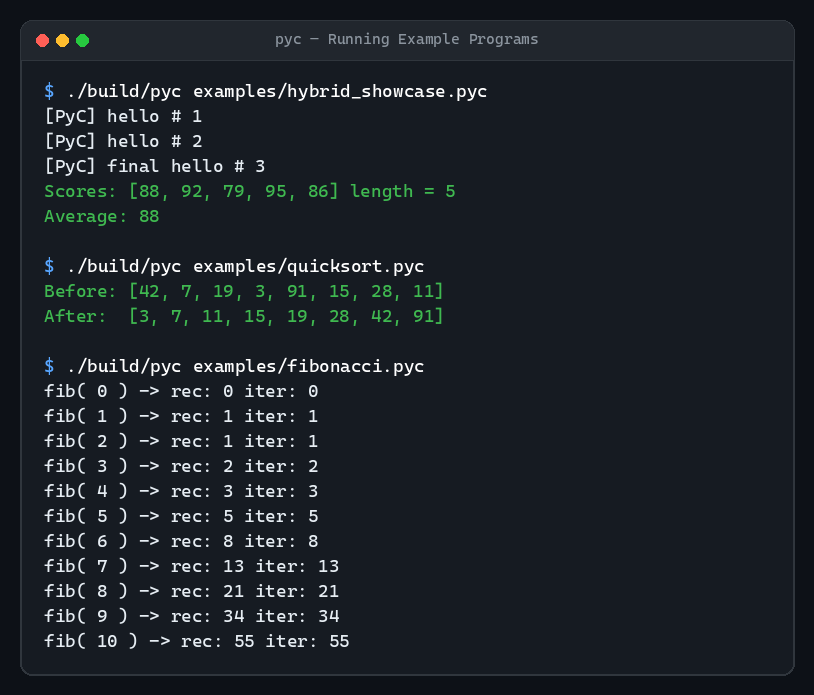
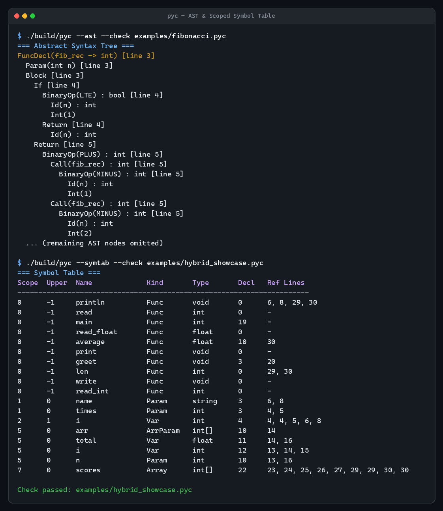
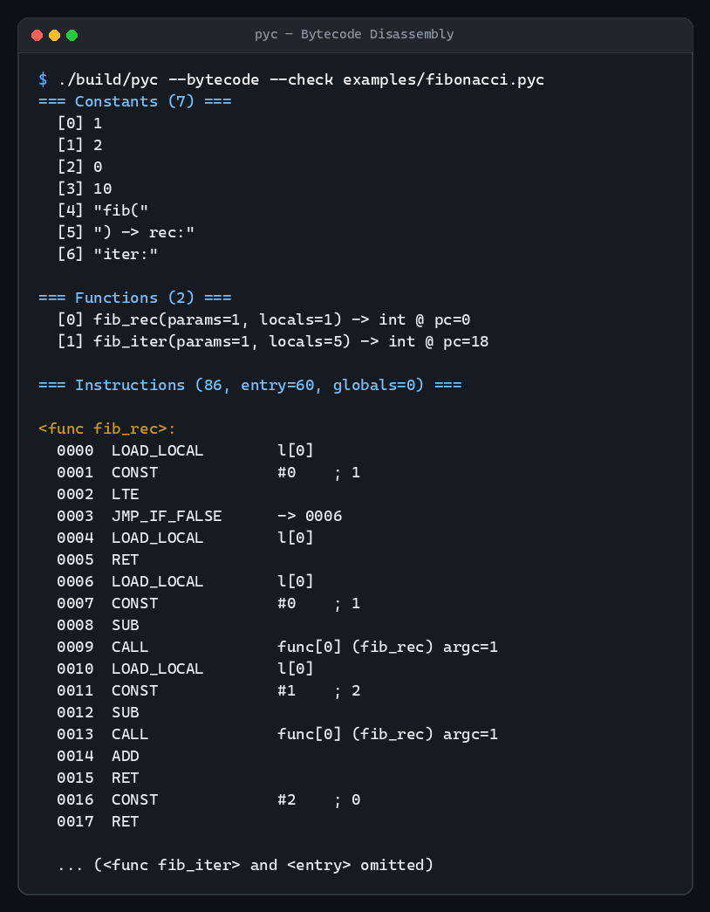
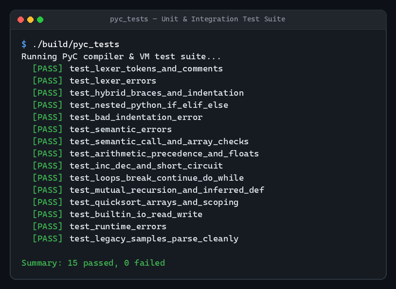

# PyC Compiler & Virtual Machine

A complete **C11 compiler and stack-based bytecode virtual machine** for **PyC** — a hybrid programming language combining **C / C-Minus** syntax with **Python-style indentation and function definitions**.

---

## Architecture & Compilation Pipeline

```text
Source (.pyc)
   │
   ▼  [1] Lexer (scanner.c)         ── Line/column tracking, logical indentation, comments & literals
TokenList
   │
   ▼  [2] Parser (parser.c, ast.c)  ── Recursive-descent parser supporting mixed {} and : blocks
  AST (TreeNode)
   │
   ▼  [3] Semantic Analyzer         ── Chained-hash scoped symbol table + type, lvalue & flow checks
Typed AST + SymbolTable
   │
   ▼  [4] Bytecode Compiler         ── Constant pool, local/global slots, loop backpatching & disasm
BytecodeProgram
   │
   ▼  [5] Stack VM (vm.c)           ── Call frames, heap arrays/strings, bounds & div-by-zero guards
Program Output
```

---

## Screenshots

### Running Example Programs


### Abstract Syntax Tree & Scoped Symbol Table


### Bytecode Disassembly


### Automated Unit & Integration Test Suite


---

## Language Features

- **Hybrid Block Syntax**
  - C-style brace blocks `{ ... }` (free-form indentation inside braces)
  - Python-style colon + indented suites `: \n <indented block>`
  - Seamless mixing (e.g., `while x > y :\n { ... }` or Python-indented `if` inside `{ ... }`)
  - Optional semicolons `;`, plus three comment styles: `//`, `/* ... */`, and `#`
- **Data Types & Arrays**
  - Primitive types: `int`, `float`, `string` (aliases `str` / `char`), `bool`, `void`
  - 1D heap-allocated arrays `T arr[N]` passed by reference to functions
  - Automatic numeric widening (`int -> float`) and string concatenation with `+`
- **Dual-Style Functions & Recursion**
  - C-style: `int fib_rec(int n) { ... }`
  - Python-style: `def fib_iter(n: int) -> int:` (return type automatically inferred from `return` statements if `-> type` is omitted)
  - Forward calls and mutual recursion supported out of the box; a 0-argument `main()` function is invoked automatically after top-level initialization
- **Control Flow & Operators**
  - Statements: `if / elif / else`, `while`, `do ... while`, `for`, `break`, `continue`, `return`, `pass`
  - Operators: `+ - * / %`, prefix/postfix `++ --`, `= += -= *= /= %=`, `== != < <= > >=`, short-circuiting `&& || !` (`and` / `or` / `not`)
- **Built-in Functions**
  - `print(...)` / `println(...)` — variadic formatted output
  - `write(x)` — single-value newline output (C-Minus compatible)
  - `read()` / `read_int()` / `read_float()` — standard input readers
  - `len(x)` — returns array or string length

---

## Project Structure

```text
.
├── CMakeLists.txt           # CMake build & CTest configuration
├── docs/
│   └── images/              # Terminal screenshots used in README
├── include/                 # Public headers
│   ├── common.h             # Checked allocators, file I/O, diagnostics
│   ├── scanner.h            # Token types and lexer interface
│   ├── ast.h                # AST node and DataType definitions
│   ├── parser.h             # Recursive-descent parser interface
│   ├── symbol_table.h       # Chained-hash hierarchical symbol table
│   ├── analyzer.h           # Semantic analyzer & type checker
│   ├── bytecode.h           # Bytecode ISA, constants & disassembler
│   └── vm.h                 # Stack VM configuration & runner
├── src/                     # Core implementation and CLI driver
│   ├── common.c
│   ├── scanner.c
│   ├── ast.c
│   ├── parser.c
│   ├── symbol_table.c
│   ├── analyzer.c
│   ├── bytecode.c
│   ├── vm.c
│   └── main.c
├── examples/                # Sample PyC programs and legacy course samples
│   ├── hybrid_showcase.pyc  # Mixed C/Python syntax showcase
│   ├── fibonacci.pyc        # Recursive & iterative Fibonacci
│   ├── quicksort.pyc        # In-place QuickSort on int[]
│   ├── legacy_pyc.txt       # Archived original lexer/parser sample
│   └── legacy_testP.txt     # Archived original parser sample
└── tests/
    └── test_runner.c        # 15 unit & end-to-end integration tests
```

---

## Build & Run

### Prerequisites
- A C11 compiler (MSVC, GCC, or Clang)
- CMake 3.16+

### Build & Test

**Linux / macOS (GCC / Clang):**

```bash
cmake -S . -B build
cmake --build build
ctest --test-dir build --output-on-failure
```

**Windows (MSVC Developer Command Prompt / VS Build Tools):**

```powershell
cmake -S . -B build -G Ninja -DCMAKE_BUILD_TYPE=Debug
cmake --build build
ctest --test-dir build --output-on-failure
```

### CLI Usage

```text
Usage: pyc [options] <source-file>

Options:
  --tokens     Print lexical token stream
  --ast        Print Abstract Syntax Tree
  --symtab     Print scoped symbol table
  --bytecode   Disassemble generated bytecode
  --trace      Trace VM instruction execution
  --check      Run frontend (and bytecode disassembly if --bytecode is set) without executing
  -h, --help   Show this help message
```

### Quick Examples

```bash
# Compile and run example programs
./build/pyc examples/hybrid_showcase.pyc
./build/pyc examples/quicksort.pyc
./build/pyc examples/fibonacci.pyc

# Inspect compiler stages without executing
./build/pyc --tokens --ast --symtab --bytecode --check examples/hybrid_showcase.pyc
```
